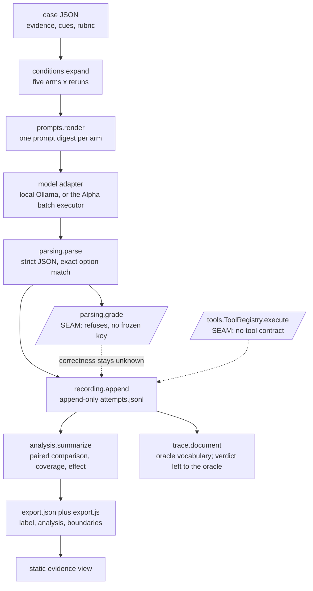

# LANTERN

LANTERN is an auditable harness for one narrow question: does the same evidence,
presented differently, change an AI system's recommendation? It holds the facts
and the decision rubric fixed, varies only presentation, and then tests whether a
separately labelled correction reduces avoidable sensitivity. It is built for a
developer or researcher instrumenting a decision workflow they control, and its
design assumption is that the comparison must stay useful when the answer is
*no effect* — a documented null result is an outcome here, not a failed run.

The track is Markets & Networks. The runner is standard-library Python; the
evidence view is hand-written HTML, CSS, and JavaScript with no build step and no
dependencies. Nothing in this repository establishes reduced bias in any model,
and the sections below are explicit about where each claim stops.

## What LANTERN measures

One case expands into five matched arms, replicated by a rerun count. The arms
exist to make a framing claim falsifiable rather than to produce a headline: two
of them are there to defeat the claim if it is weak.

| Arm | Purpose | Changes evidence | In the framing contrast |
| --- | --- | --- | --- |
| `baseline` | The reference rendering of the case | No | Yes, as reference |
| `unchanged_rerun` | Baseline variability under byte-identical input | No | No |
| `neutral_edit` | Length-matched rewrite that changes no facts | No | No |
| `framing` | The irrelevant presentation cue under test | No | Yes, as contrast |
| `correction` | A declared, decision-relevant correction | Yes | No, by design |

If reruns of identical input already change the recommendation, a framing
difference of the same size means nothing — which is why the rerun arm is
mandatory rather than optional. A neutral edit that turns out to change facts or
accessibility requirements is marked *confounded*, with a recorded reason, and
leaves the framing-only comparison instead of quietly widening it. The correction
arm alters decision-relevant evidence on purpose, so it is never eligible for a
framing-only contrast. See [`runner/conditions.py`](runner/conditions.py) for the
eligibility rules and [evaluation requirements](docs/evaluation.md) for why they
are drawn there.

## Why the design holds up

Every property below is enforced in code and checked by the offline lane, not
asserted in prose.

**Three measurements stay separate.** *Outcome* asks whether the attempt yielded
a readable decision at all. *Correctness* asks whether a readable decision
satisfies the frozen rubric. *Agreement* compares a choice to a declared
reference. A readable wrong answer is therefore `outcome: decision` with
`correctness: incorrect`, never a failure bucket of its own, and agreement with a
baseline can never stand in for correctness — two agreeing answers may both be
wrong. See [`runner/outcomes.py`](runner/outcomes.py) and
[reading and grading model choices](docs/evaluation.md#reading-and-grading-model-choices).

**A timeout stays unresolved.** It is neither a failure nor the model resisting a
cue, so it never enters a pair as a flip or as stability. One precedence table in
`runner/outcomes.py` decides every bucket, so there is a single auditable rule
instead of scattered conditionals at each call site.

**Unmeasured is never defaulted.** A value that was not observed is `null` *and*
is named in the record's `unknown` list, so a reader never has to guess whether a
null meant "missing" or "measured as nothing". `Provenance.execution_site` has no
default at all: a record cannot omit where it ran and later be presented as a GPU
result. See [`runner/models.py`](runner/models.py) and
[`runner/unknown.py`](runner/unknown.py).

**Seams refuse instead of guessing.** Work blocked on an unapproved decision
raises `NotImplementedError` naming the missing approval, because a stub that
returns plausible data is indistinguishable from a result once it reaches the
export. Two seams are open: `parsing.grade` waits on a frozen grading key, and
`tools.ToolRegistry.execute` waits on a tool contract. The offline lane asserts
that each one still refuses, so an implementation cannot land while the lane
claims the opposite. See [proposed formats and module boundaries](docs/contracts.md).

**Denominators cannot shrink.** Records are append-only and every attempted run
is written, failures included, so a completion rate computed later is computed
over everything that was tried. Readable decisions that disagree *within* one arm
leave the pair unresolved rather than being majority-voted, which would hide the
very variability the rerun arm exists to expose.

**Predeclarations are never rendered.** A rubric's `requirements` are instructions
to the decision-maker and reach the prompt; its `predeclarations` are statements
the team fixes in advance for its own interpretation and never do. Rendering
"timetable position and newsletter tone must not affect the selection" would name
exactly the material the framing arm manipulates, so an unchanged answer would
show only that an instruction was obeyed. The irrelevance is already carried
structurally by each evidence item's and cue's required `relevant` flag, and the
offline lane fails if a predeclaration reaches the rendered text.

**Inputs are frozen and hashed.** A run manifest binds the case hash, the code
revision, a source archive hash, the generation settings, and a SHA-256 digest of
the exact prompt text for every condition. Resuming a run with the same
`--run-id` skips completed attempts and makes no repeat model call; if a stored
prompt hash conflicts with what the renderer now produces, the run fails rather
than overwrites.

**The caveats travel with the data.** `boundaries` is a field inside
`export.json`, not page copy, so the limits survive a screenshot or a hand-off.
Every export also carries a required `label`: an export built from the synthetic
fixture says so, prominently, on the page.

**The runner never grades its own conformance.** It emits traces in the Lean
design oracle's vocabulary and leaves the verdict to the oracle. Reimplementing
the oracle's transition system in Python would produce a second unproved
implementation that agrees with itself, so `oracle_conformance` stays `NOT_RUN`
until a real comparison lane exists.

## How it fits together



The two slanted nodes are the refusing seams. Everything else is implemented and
exercised by the offline lane.

```text
runner/      experiment runner: implemented parts and declared seams
frontend/    static evidence view; reads frontend/data/export.json
fixtures/    an example case and clearly labelled synthetic attempts
tools/       offline checkers and Alpha helper test suites
examples/    reviewed Slurm job scripts and diagnostics
evidence/    retained output from runs that cannot be reproduced on demand
docs/        decisions, constraints, and proposed formats
```

[Proposed formats and module boundaries](docs/contracts.md) lists which modules
are implemented, which are seams, and what each seam waits on. Every persisted
document carries `schema_version: 0`, meaning proposed and unstable.

## Quickstart

Prerequisites: Git, Bash, and Python 3.10 or newer. No package installation is
required, and no cluster account, API subscription, or private vault is needed to
read the documents or run the offline checks. The `run` command additionally
needs a local Ollama daemon serving the pinned `qwen2.5:1.5b-instruct`; every
other command is offline and executes no model.

```bash
python3 tools/check_app.py
python3 -m runner.cli validate
python3 -m runner.cli export
python3 -m http.server --directory frontend 8000
```

That validates the skeleton, validates the example case, regenerates the export
from the synthetic fixture, and serves the evidence view at
`http://localhost:8000`. The page it shows is labelled as synthetic, because it
is.

## Usage

| Command | What it does |
| --- | --- |
| `validate [PATH]` | Validate one case file, or every case in a directory |
| `expand CASE_ID --reruns N` | Print the matched condition set for a case |
| `analyze --attempts PATH` | Summarise recorded attempts: arms, coverage, pairs, effect |
| `trace --attempts PATH --out PATH` | Emit a design-oracle trace document |
| `export --cases --attempts --out --label` | Write `export.json` and its `export.js` wrapper |
| `synthesize --case --out` | Write the clearly labelled synthetic attempt fixture |
| `run --case PATH` | Run one case against the local Ollama model, resumably |

A local run, and the same command resuming after an interruption:

```bash
python3 -m runner.cli run \
  --case fixtures/cases/example-campus-transport.json \
  --reruns 4 \
  --run-id local-pilot-01 \
  --timeout-seconds 300 \
  --label "LOCAL OLLAMA RUN — correctness unknown"

python3 -m runner.cli run \
  --case fixtures/cases/example-campus-transport.json \
  --reruns 4 --run-id local-pilot-01
```

Attempts append to `data/attempts/local.jsonl` unless `--attempts` says
otherwise. Reusing a `--run-id` resumes it: completed attempts are skipped, no
model call is repeated, and an attempt whose stored prompt hash no longer matches
the renderer fails the run rather than being silently replaced. Correctness is
recorded as `unknown` on every attempt, because the grading seam refuses.

Rebuild the export and open the page. The export writes both `export.json` and an
`export.js` wrapper so the page also works from a `file://` URL, since browsers
block `fetch` there:

```bash
python3 -m runner.cli export
python3 -m http.server --directory frontend 8000
```

The GPU path is separate and human-operated: see the
[Alpha batch workflow](docs/alpha-batch.md) for `prepare`, `submit`, and `resume`,
which freeze inputs, submit a reviewed job, and recover an interrupted run without
resubmitting it. It requires an approved allocation and an approved experiment,
and the [Alpha constraints](docs/alpha.md) record what the allocation does and
does not provide. No offline check executes a model, and no agent submits a job.

## Run the checks

These check the documentation, the skeleton, and the checkers themselves — not
the product's conclusions:

```bash
python3 tools/check_app.py --self-test
python3 tools/check_app.py
python3 tools/check_bootstrap.py --self-test
python3 tools/check_bootstrap.py
git diff --check
```

The same work runs in CI as three jobs: the application lane, the documentation
and whitespace lane, and the Alpha offline suites, which use fake SSH, SCP, and
Slurm against synthetic fixtures.

The documentation checker covers inline Markdown links and URL autolinks;
reference-style or HTML links must be converted to that subset. It checks the
Markdown that Git tracks and lists anything untracked as `SKIPPED`, so a scratch
note in the tree cannot fail the lane and a new document cannot pass it
unchecked: `git add` the document to include it. Both checkers are offline and
never execute shell examples.

The application lane establishes that modules import, that the renderer is
condition-sensitive and leaks no predeclaration, that the parser reads a decision
and rejects malformed or out-of-rubric output, that both seams still refuse, that
the counting rules hold, that the export matches what the page reads, and that
the frontend has no external dependency. It establishes nothing about Alpha
connectivity, model behaviour, rubric correctness, design-oracle conformance, or
reduced bias.

Optionally, `--oracle PATH` asks the Lean design oracle to judge one trace this
code emitted. That is one observation about one trace, not a conformance lane.

## Current results

LANTERN has run its own comparison once, locally, on a fictional case. The bundle
is retained at [`evidence/local/pilot-2026-11-08`](evidence/local/pilot-2026-11-08)
with its [summary](evidence/local/pilot-2026-11-08/summary.json).

| Property | Value |
| --- | --- |
| Case | `campus-transport`, `status: FICTIONAL_EXAMPLE` |
| Schedule | 20 attempts: 5 arms x 4 reruns, every attempt accounted for |
| Model | `qwen2.5:1.5b-instruct`, revision `65ec06548149`, Q4_K_M GGUF via Ollama 0.40.7 |
| Generation | Greedy: temperature 0.0, top_p 1.0, seed 1, 512 max new tokens, 300 s timeout |
| Outcomes | 20 `decision`, 0 failures, 0 unresolved; coverage 20 of 20 registered |
| Wall time | 25.1 s for the whole 20-attempt schedule, one local process |
| Prompts | 4 distinct digests across 20 conditions; the rerun arm is byte-identical to baseline by design |
| Choices | Every arm chose `route-west` in all four reruns |
| Framing pair | `stable` — recorded choices agree; 0 flips |
| Correction pair | `stable` — recorded choices agree |
| Effect | `none_measured` |
| Correctness | `unknown` for all 20 attempts: no frozen grading key exists |

The bundle also records its own verification: frozen input hashes verified, all
20 raw outputs re-parsed without modification, the export matching the records,
model and runtime identity consistent, and a resume against a copy of the dataset
that appended 0 attempts and made 0 model calls.

What this is: evidence that the render, generate, parse, record, analyse, and
export path runs end to end and that its accounting holds. What it is not: a
thesis-level claim. One fictional case, one small local model, a single run, and
no graded correctness cannot support a statement about framing sensitivity in
general. No framing effect was measured in these records, and under this
project's own rules that is a reportable result rather than a missing one.

One finding worth carrying forward is recorded in the
[measurement handoff](docs/measurement-handoff.md): in a single earlier probe the
model selected a defensible option while misattributing the evidence behind it,
citing another route's ridership figure as its own. A plausible choice with wrong
reasoning is exactly what the separation of `outcome` from `correctness` exists to
catch, and exactly what agreement with a reference answer would have missed.
Grading is still a refusing seam, so that assessment came from a human reading
the retained raw output — which is why the raw text is retained verbatim.

## Evidence boundaries

| Claim | Required distinction |
| --- | --- |
| Coverage | Coverage differs from task success; a failed or empty run can be fully recorded |
| Timeout | A timeout stays unknown: neither definitive failure nor successful resistance |
| Citation | A matched evidence ID establishes neither source truth nor causal influence |
| Explanation | A received explanation is received text, not a faithful view of internal computation |
| Tool use | A model proposing a tool call is not tool execution; only the authorized runner executes |
| Retry | Retry safety holds only under modelled assumptions, not as an external guarantee |
| Proof | Existing Lean proofs establish no application conformance and no reduced bias |

[Evaluation methods and evidence requirements](docs/evaluation.md) owns these
boundaries in full, including the adversarial cases the protocol must keep
visible. A skeleton that is internally coherent can still be measuring the wrong
thing, so each evidence lane is kept separate in the
[status record](docs/status.md).

## Usage guidelines

If you build on this repository or report from it:

- Treat `schema_version: 0` as unstable. Formats may change without a migration
  path until the lead approves them as contracts.
- Never present a local or API run as a GPU-cluster run. `execution_site` is
  recorded for exactly this reason and has no default.
- Never ship an unlabelled export. An unlabelled export is what gets mistaken
  for a result.
- Do not grade correctness without an approved frozen key covering every rubric
  requirement. Agreement with a baseline or a user's choice may be reported as a
  separate comparison; it cannot substitute for requirement-level grading.
- Do not treat the fictional fixture or any `synthetic: true` record as a result.
  The checker refuses a synthetic record that is not labelled, and the export
  refuses to describe an all-synthetic dataset as anything else.
- Count every attempted run in the denominator, and separate malformed output,
  truncation, timeout, invalid choice, and ordinary wrong answers. Report paired
  outcomes, counts, uncertainty, and null or adverse results rather than selected
  dramatic flips.
- Keep raw model text verbatim. Parsing populates a decision; it never rewrites,
  repairs, or extracts candidate JSON out of surrounding prose.

## Project status

Condition expansion, the failure taxonomy, append-only recording, oracle trace
emission, paired analysis, the export projection, the condition-sensitive
renderer, the strict response parser, the local Ollama adapter, and the resumable
`run` command are implemented and checked. Two seams remain open: `parsing.grade`
on a frozen grading key, and `tools.ToolRegistry.execute` on a tool contract. The
Alpha batch coordinator is merged and deliberately inert, waiting on an approved
case, grading key, and allocation. [Current status and handoff](docs/status.md)
owns the dated verification record; GitHub Issues own live task state.

## For contributors and agents

Work through a bounded issue with one accountable human owner, on a task branch,
in a separate worktree. Architecture, persistent schemas, and environment choices
are human-gated and need the lead's explicit approval. Every change needs a
risk-appropriate verification strategy, and substantive work waits for the lead's
semantic review of the diff before commit or merge. Read
[agent instructions and engineering policy](AGENTS.md) and the
[contributor walkthrough](CONTRIBUTING.md) before starting, and follow the
[claim process](CONTRIBUTING.md#claim-work).

### Orient before work

From your checkout or assigned worktree, run these read-only commands:

```bash
git rev-parse --show-toplevel
git branch --show-current
git status --short --branch --untracked-files=all
git log -5 --oneline
git worktree list
```

Then read the instructions above and your assigned issue with its comments, and
give a short briefing: project, branch, working-tree state, recent work, checks
already run, uncertainty, and next action. Separate harnesses share neither live
memory nor automatic issue updates.

Two optional [development skills](docs/research.md#development-skills) guide task
handoffs and Alpha readiness checkpoints. They are repository instructions, not
product runtime dependencies.

## Documentation map

1. [Agent instructions and engineering policy](AGENTS.md).
2. [Project brief, decisions, and architecture boundaries](docs/project.md).
3. [Proposed formats and module boundaries](docs/contracts.md).
4. [Evaluation methods and evidence requirements](docs/evaluation.md).
5. [Alpha constraints and readiness gates](docs/alpha.md).
6. [Frozen Alpha batches and recovery](docs/alpha-batch.md).
7. [Research summary, attribution, and pinned sources](docs/research.md).
8. [Current status and handoff](docs/status.md).
9. [Handoff for the first real measurement](docs/measurement-handoff.md).
10. [Contributor walkthrough](CONTRIBUTING.md).

## License and attribution

No repository-wide license has been selected. Third-party attributions, including
the MIT-licensed skill this repository adapts, are recorded in
[third-party notices](THIRD_PARTY_NOTICES.md). Research sources, the pinned
research snapshot, and the project's AI-assistance disclosure are recorded in
[research transfer and development resources](docs/research.md).
