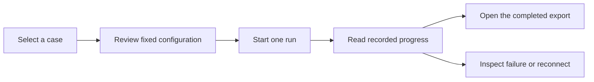

# Browser-run workflow: design handoff

This is a proposal for a later implementation. The current frontend opens
exported results; it does not start experiments. Andrew retains ownership of
the orchestration command in issue 16. No API, job store, model configuration,
or server architecture is introduced by this document.

## User journey

1. **Select a case.** Show the backend's available cases, their evidence, and
   approval status. A fictional case must say pilot before the user starts.
   Do not invent an approved case while the agreed case is unavailable.
2. **Review configuration.** Show the backend's fixed model and revision,
   runtime, repetitions per arm, five-arm schedule, and planned attempt count.
   Keep model and generation settings read-only. Explain that correctness is
   ungraded and that stable or insufficient results are valid outcomes.
3. **Start.** An explicit action requests one run. Disable duplicate starts
   while that request is pending. The backend must resolve repeated requests
   to the same run rather than creating duplicate experiments.
4. **Progress.** Show recorded attempts against the frozen schedule, with
   backend-reported outcomes. Do not invent percentages from elapsed time.
   Completion of all attempts does not imply every attempt was successful.
5. **Results.** Open that run's existing export in the evidence viewer. Keep
   the run identity, source, fictional-case status, and evidence boundaries
   visible. Never combine a new run with the previously displayed dataset.

## Required backend capabilities

The browser needs to discover readiness and cases, request a run, retrieve its
identity and status, and fetch its export. The service should delegate execution
to Andrew's runner so rendering, parsing, recording, failure classification,
resumption, and model/runtime isolation have one implementation.

Recommend one active local run at a time for the first version. An unavailable
daemon should be reported before starting when detectable; failures after an
attempt begins must remain recorded. A failed run must retain completed
records and distinguish scheduled attempts from attempted ones.

If a start response or progress connection is lost, say that the run's status
is unknown and reconnect to its identity. Do not silently retry the experiment
or display a simulated completion. Cancellation is outside the first version;
do not add a Stop button without a backend contract for preserving records.

## Architecture decision before implementation

The recommendation is a local, same-origin service that serves the existing
static frontend and delegates runs to the CLI. It offers an integrated user
experience but introduces process supervision, request validation, access
controls, and recovery responsibilities. The current terminal-and-export
workflow is the alternative: simpler and portable, with a manual handoff.

The lead must approve the service boundary and lifecycle before code is
written. Coordinate request/status contracts with Andrew after the CLI is
ready; do not impose new flags or change his claimed files from frontend work.
No database or container is required by this proposal. Decide any persistent
job state separately, including recovery and rollback. Preserve direct export
opening as a usable fallback if the service is removed.

Acceptance for that later implementation must cover duplicate starts,
unavailable backend, recorded attempt failures, loss of connection after start,
reconnection to the same run, and the exact completed export reaching the
viewer. There is no runnable browser-execution acceptance command today;
the API and implementation are deliberately deferred.
