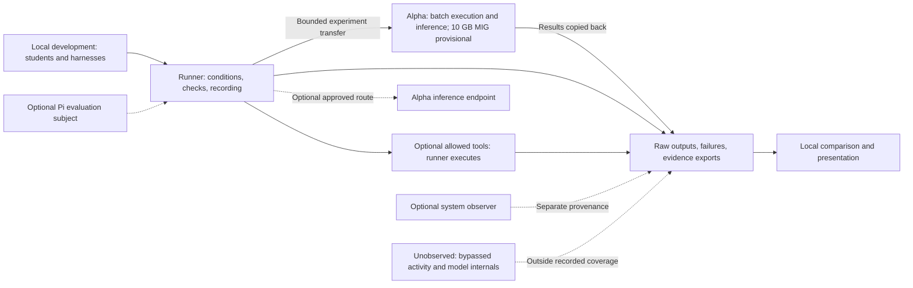

# Project brief and decisions

## Goal and audience

LANTERN tests whether the same evidence leads AI systems to different
recommendations when its presentation changes, then shows whether a specific
correction helps. The first audience is a developer or researcher evaluating a
workflow they can instrument. A useful comparison must remain useful when the
experiment finds no effect.

Approved requirement: Markets & Networks is the track. The lead approved the
framing/correction direction, batch-first responsibilities, provisional team
roles, portable Bash, and scoped issue updates during planning on November 7,
2026. Implementation of this bootstrap was subsequently requested. That is not
approval to implement every proposal in the research notes.

## Approved responsibilities

These boxes describe responsibilities, not required services. The batch runner
may execute beside the model on Alpha. Development harnesses help students write
and review code; they are not automatically the experiment's model subjects.
Only the authorized runner executes allowed tools. Model-proposed calls alone
establish no execution. The recorder is trusted and observes instrumented
boundaries, not everything that happens on either machine.

## Alternatives and tradeoffs

Batch-first work avoids making a live endpoint and laptop-to-compute networking
prerequisites. It allows portable result exports but gives less live interaction.
Serving can be considered after inference and throughput gates pass; failure of
that later route should leave batch experiments usable.

Information exposure/ranking remains the meaningful product alternative: reorder
a fixed set of campus notices and measure what a digest omits. It offers a direct
information-access story, but relevance labels and assumed attention weights
need justification. Network propagation is a stretch after a reproducible
single-step comparison, not an initial multi-agent architecture.

Adversarial cases: a correction changes facts; source authority legitimately
matters; unchanged reruns vary; a model times out instead of resisting a cue;
the recorder misses a call; an impressive comparison hides unsupported claims.
Use the [evaluation requirements](evaluation.md) to expose these failures rather
than selecting dramatic examples.

## Decisions still required

The lead must explicitly approve runtime language/frameworks, model/revision,
environment setup, persistent case/result schemas, tool contracts, and major
component changes before implementation. No database, collector service,
container, model server, or UI framework is selected by this bootstrap.

A fictional campus-transport packet and a neutral evidence-table correction are
recommendations from the research, not approved fixtures or contracts. The team
must agree the rubric, relevant versus irrelevant cues, and case format before
parallel product work. Evaluation counts follow measured latency, not the old
shopping-demo timetable.

No application migration is needed yet. Keep optional serving, tracing, and Pi
subject integration out of the core until their separate gates pass. Any later
schema change needs an approved migration/rollback plan; no such schema is
introduced here.

## Team responsibility

| Teammate | Person | Responsibility |
| --- | --- | --- |
| A | Losera, lead/integrator | Integration, shared contracts, architecture decisions, and review |
| B | Name pending | Context, evidence, and evaluation review; issue 2 |
| C | Name pending | Contributor walkthrough and collaboration checks; issue 3 |

The lead also owns instructions, dependency/build files, and verification
tooling. B and C describe proposed responsibility slots; their issues remain
unassigned until the lead agrees actual names and grants path claims.

Each claimed issue has one named human owner. Record the agent session
separately; a session change does not transfer ownership or release a claim.
Several issues may share an owner, but each path/component has one active writer.
See the [issue workflow](../CONTRIBUTING.md#teammate-ownership-and-messageboard).

## Source basis

The [research manifest](research.md#source-manifest) links the November 7 snapshot
and distinguishes recommendations from the older shopping architecture. Current
decisions live here; historical proposals remain in the research vault.
